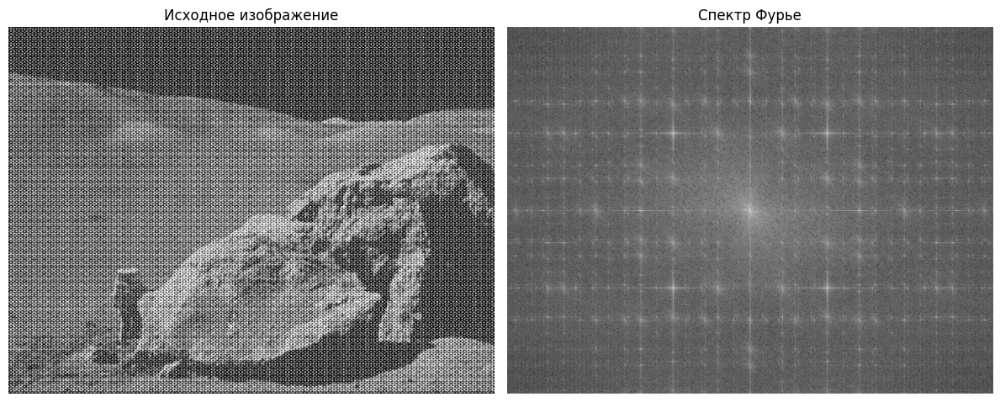
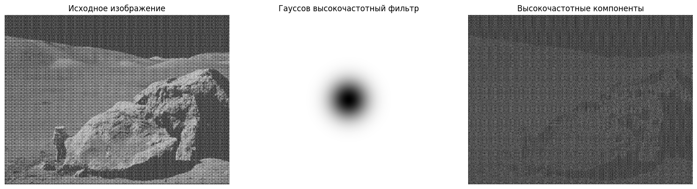
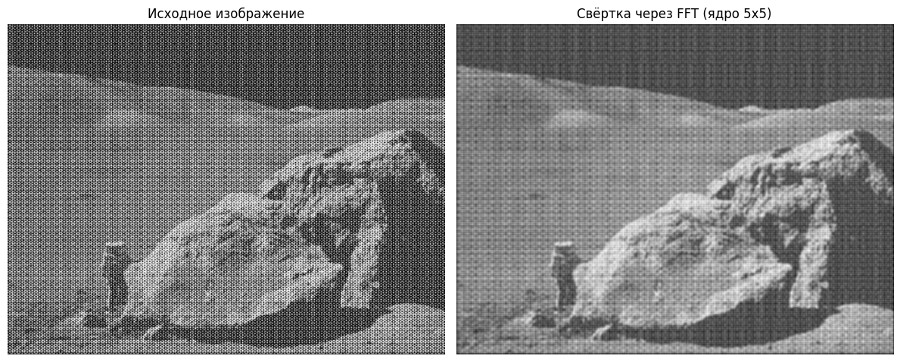
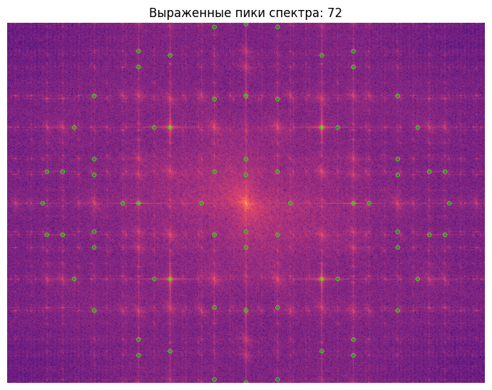
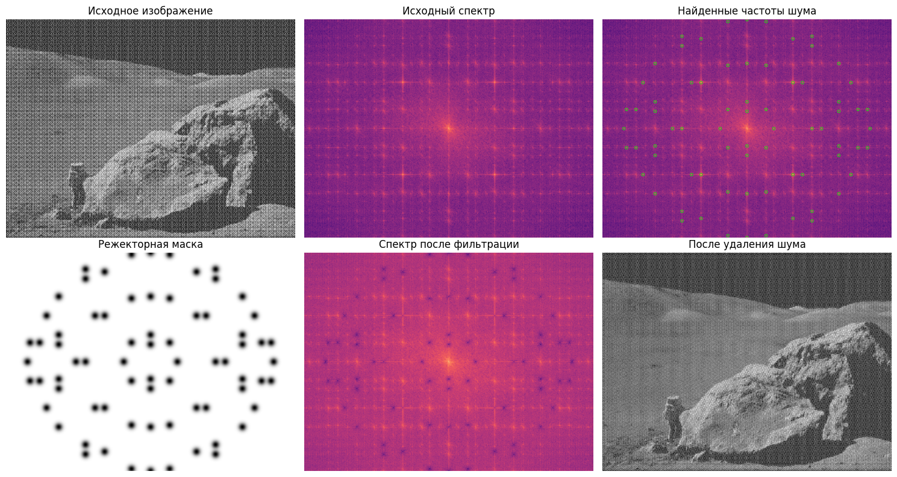
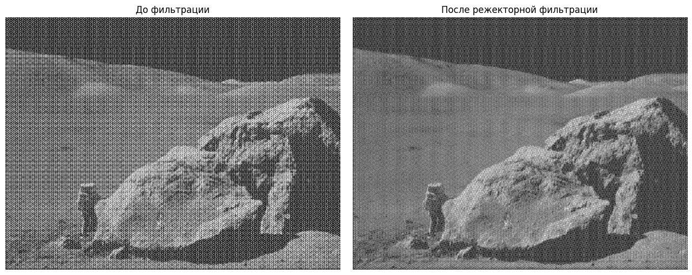

# Лабораторная 5. Частотная фильтрация

[Открыть и выполнить в Google Colab](https://colab.research.google.com/github/GEVORGTERMINATOR/-/blob/main/fifth_lab/IP_TASK5.ipynb)

Исходная работа: [Kate-Nits / IMAGE_PROCESSING](https://github.com/Kate-Nits/IMAGE_PROCESSING).

## Исходное изображение и спектр Фурье

## Высокочастотная фильтрация на основе ядра Гаусса

## Вычисление свёртки с помощью преобразования Фурье

## Удаление периодического шума с помощью преобразования Фурье

## Сравнение изображения до и после удаления шума

