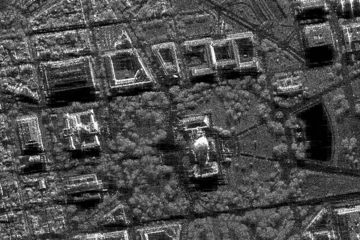
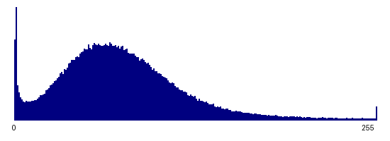
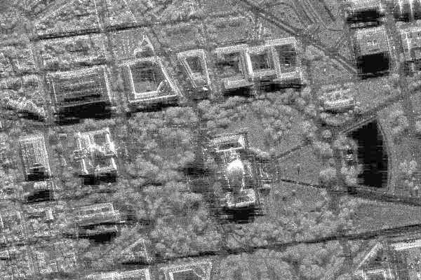
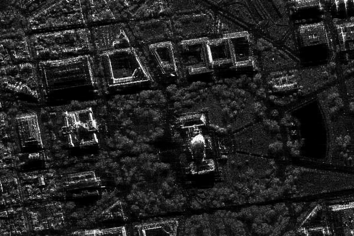
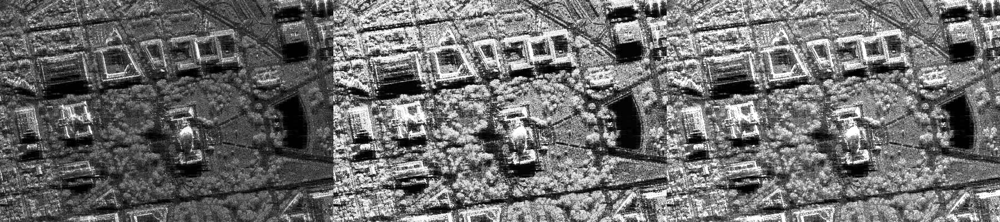
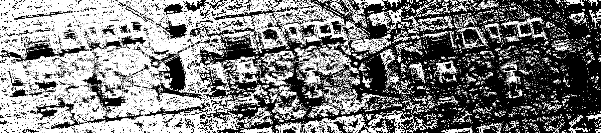

[Открыть в Google Colab](https://colab.research.google.com/github/GEVORGTERMINATOR/-/blob/main/first_lab/IP_TASK1.ipynb)

# Лабораторная 1. Яркость и контраст
Исходный снимок sar_1_gray.jpg взят из материалов [первого задания](https://github.com/Kate-Nits/IMAGE_PROCESSING/tree/main/first_lab). В Colab снимок загружается автоматически.



## Распределение яркости
По горизонтали — уровни от 0 до 255, по вертикали — число пикселей. Высота самого высокого столбца указана под графиком.



```text
Максимум: 3786 пикселей на уровне 1.
```

## Гамма-коррекция и сравнение с оригиналом
Считаем MSE по всем пикселям, SSIM — по скользящим окнам 7×7 с выборочными дисперсиями и усреднением по валидной области.






```text
γ=0.55   MSE=2484.36   SSIM=0.8197   средняя яркость=123.5
γ=1.00   MSE=0.00   SSIM=1.0000   средняя яркость=74.9
γ=1.80   MSE=1793.44   SSIM=0.6415   средняя яркость=35.0
```

## Статистическая коррекция
Сначала выравниваем гистограмму. Затем используем среднюю яркость и стандартное отклонение выровненного снимка как целевые значения для линейного преобразования оригинала.



```text
Оригинал: среднее 74.9, стандартное отклонение 43.7
Эквализация: среднее 127.0, стандартное отклонение 74.3
Коррекция: среднее 123.6, стандартное отклонение 65.3
```

## Бинаризация
Пороги выбираем по квартилям яркости. Белым отмечаем пиксели ярче порога. Маски показаны слева направо по возрастанию порога.



```text
Порог 46: белые пиксели занимают 74.4% площади
Порог 70: белые пиксели занимают 49.6% площади
Порог 98: белые пиксели занимают 24.5% площади
```

## Вывод
Гамма меньше единицы осветлила полутона, больше единицы — затемнила. При единичной гамме контрольное сравнение даёт MSE = 0 и SSIM = 1. Чем выше порог бинаризации, тем меньшая часть снимка попадает в белую область.
