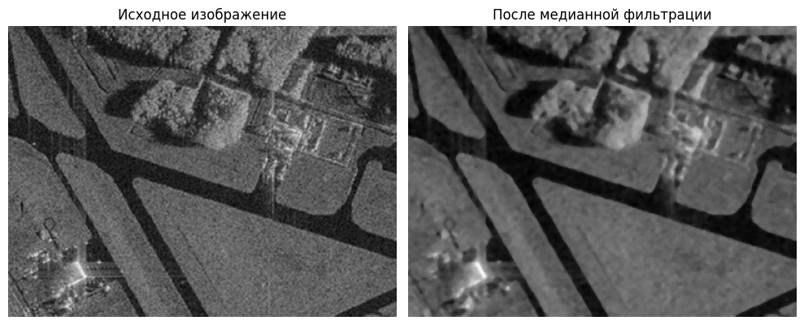
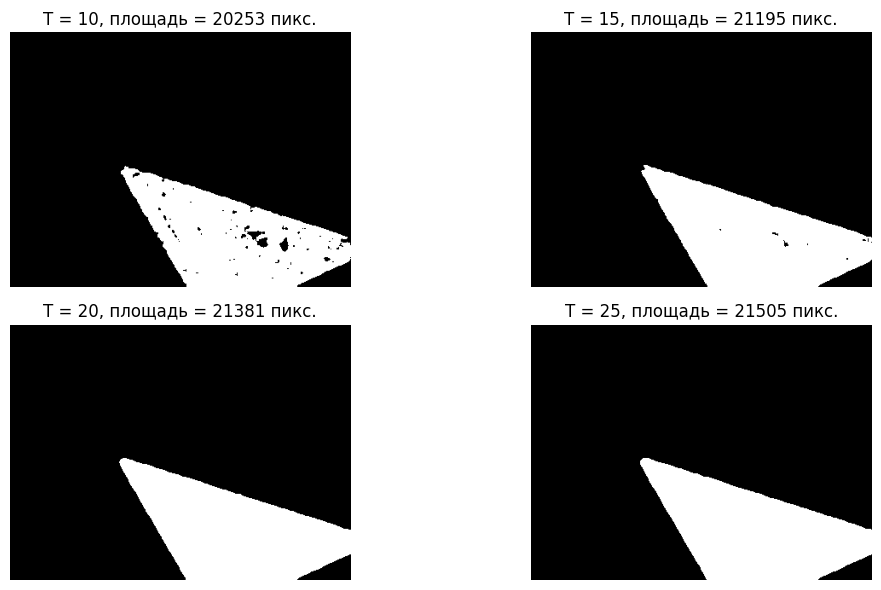
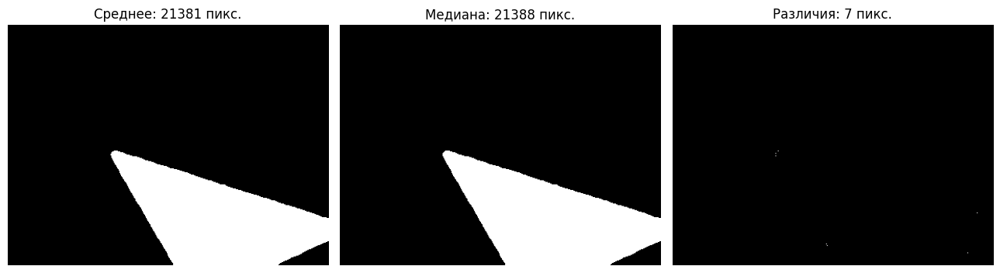
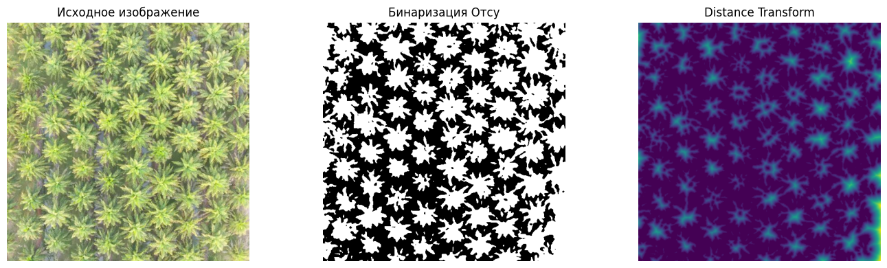
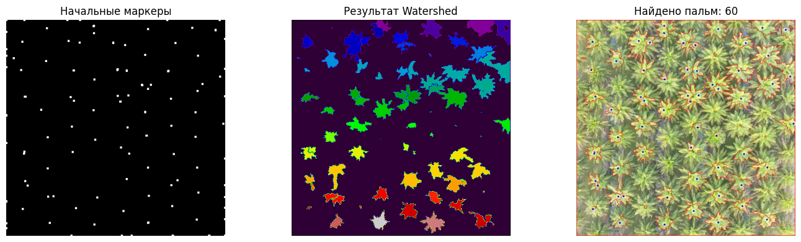

# Лабораторная 4. Сегментация и подсчёт пальм

[Открыть и выполнить в Google Colab](https://colab.research.google.com/github/GEVORGTERMINATOR/-/blob/main/fourth_lab/IP_TASK4.ipynb)

Исходная работа: [Kate-Nits / IMAGE_PROCESSING](https://github.com/Kate-Nits/IMAGE_PROCESSING).

## Исходное изображение

## Алгоритм разрастания регионов

## Подбор параметров разрастания регионов

## Сравнение критериев однородности

## Watershed + Distance Transform

## Сегментация Watershed и подсчёт пальм

