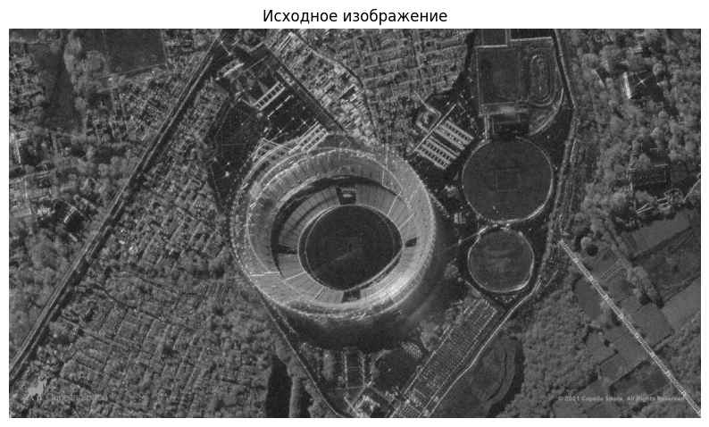
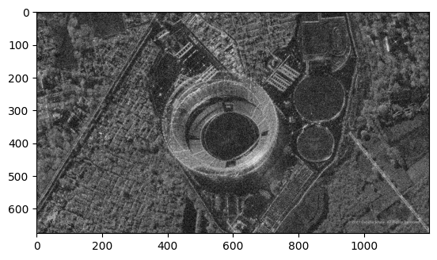
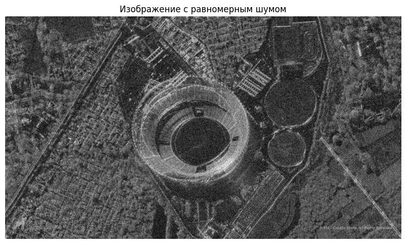
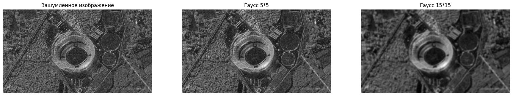
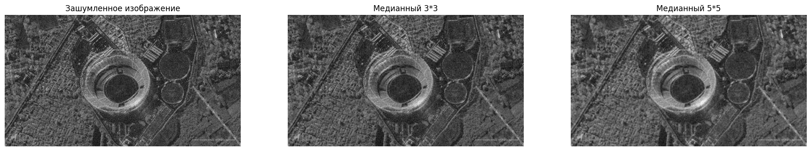
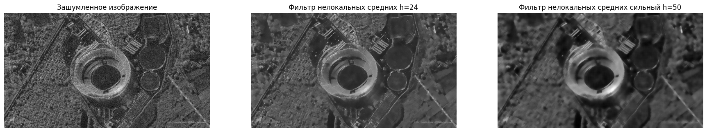
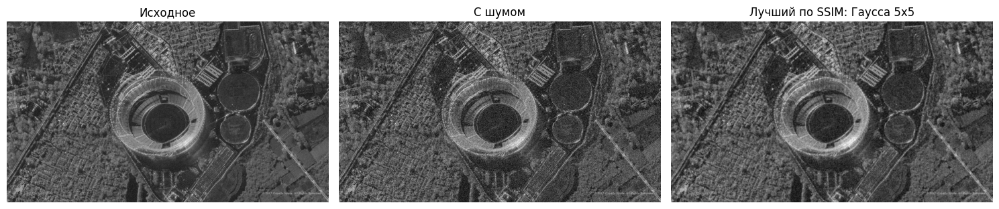

# Лабораторная 2. Подавление шума

[Открыть и выполнить в Google Colab](https://colab.research.google.com/github/GEVORGTERMINATOR/-/blob/main/second_lab/IP_TASK2.ipynb)

Исходная работа: [Kate-Nits / IMAGE_PROCESSING](https://github.com/Kate-Nits/IMAGE_PROCESSING).



## Шум Гаусса



## Постоянный (равномерный) шум



## Тестирование алгоритмов подавления шума Гаусса



```text
176.88734814814813 0.6766204486820742
```

## Медианный фильтр



```text
258.9386901234568 0.5892536166907719
```

## Билатеральный фильтр


```text
186.8786851851852 0.6646623513332666
```

## Фильтр нелокальных средних



```text
209.11676666666668 0.6132542837901126
```

## Сравнение фильтров

```text

ГАУССОВСКИЙ ШУМ
-----------------------------------------------------------------
До фильтрации: MSE = 864.99, SSIM = 0.4057

Фильтр                                  MSE       SSIM
-----------------------------------------------------------------
Гаусса 5x5                           176.89     0.6766
Гаусса 15x15                         389.04     0.3503
Медианный 3x3                        258.94     0.5893
Медианный 5x5                        260.05     0.5378
Билатеральный d=5                    186.88     0.6647
Билатеральный d=10                   260.37     0.5241
Нелокальных средних h=24             209.12     0.6133
Нелокальных средних h=50             375.78     0.3782

Лучший по MSE: Гаусса 5x5
MSE = 176.89

Лучший по SSIM: Гаусса 5x5
SSIM = 0.6766
```


## Тестирование фильтров для равномерного шума

```text

РАВНОМЕРНЫЙ ШУМ
-----------------------------------------------------------------
До фильтрации: MSE = 823.50, SSIM = 0.4157

Фильтр                                  MSE       SSIM
-----------------------------------------------------------------
Гаусса 5x5                           172.27     0.6834
Гаусса 15x15                         387.64     0.3513
Медианный 3x3                        311.05     0.5431
Медианный 5x5                        283.85     0.5097
Билатеральный d=5                    182.42     0.6704
Билатеральный d=10                   258.45     0.5269
Нелокальных средних h=24             197.75     0.6199
Нелокальных средних h=50             373.30     0.3802

Лучший по MSE: Гаусса 5x5
MSE = 172.27

Лучший по SSIM: Гаусса 5x5
SSIM = 0.6834
```


