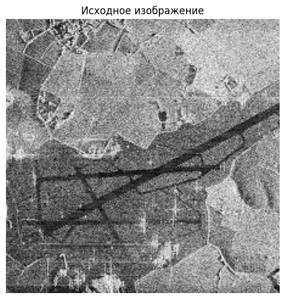
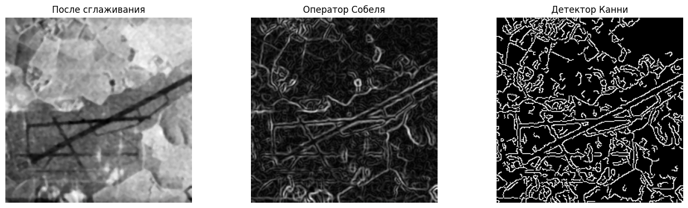
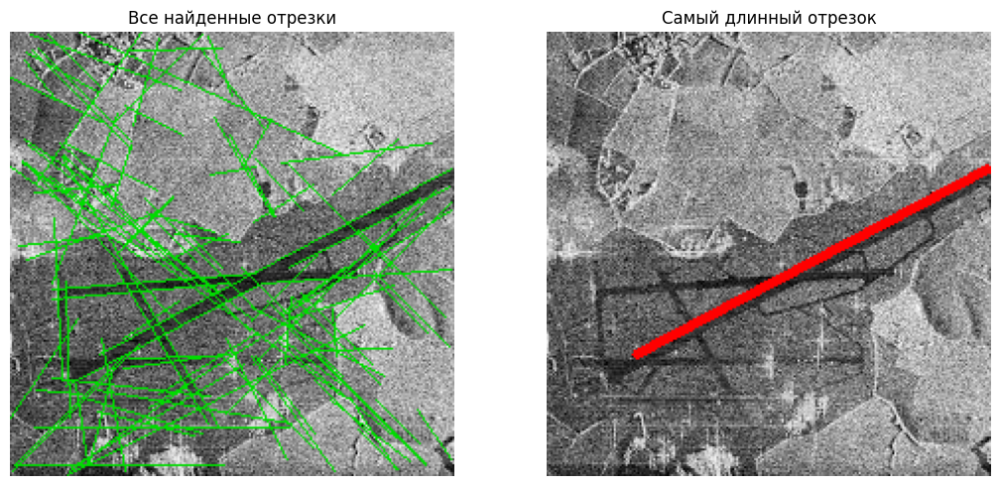
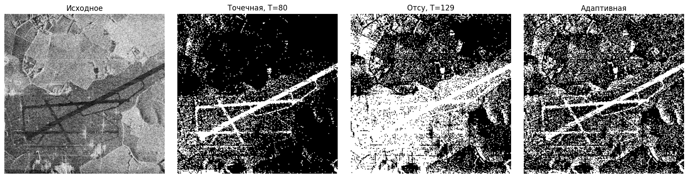
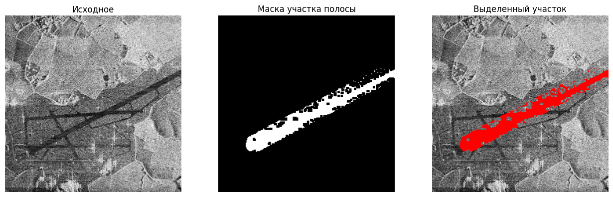

# Лабораторная 3. Выделение дороги

[Открыть и выполнить в Google Colab](https://colab.research.google.com/github/GEVORGTERMINATOR/-/blob/main/third_lab/IP_TASK3.ipynb)

Исходная работа: [Kate-Nits / IMAGE_PROCESSING](https://github.com/Kate-Nits/IMAGE_PROCESSING).

## Исходное изображение



## Выделение границ изображения



## Преобразование Хафа, поиск наиболее протяженного участка

```text
Всего найдено отрезков: 116
Самый длинный отрезок: (45, 163) — (223, 69)
Длина: 201.30 пикселя
```



## Исследование алгоритмов бинаризации

```text
Порог Отсу: 129
```



## Выделение участка дорожной полосы


